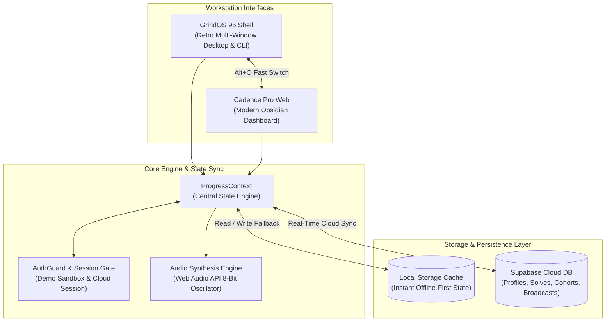

<div align="center">

# GrindOS 🔥
### The Dual-Engine Algorithmic Placement Operating System

[](https://react.dev/)
[](https://www.typescriptlang.org/)
[](https://vite.dev/)
[](https://tailwindcss.com/)
[](https://supabase.com/)
[](https://vitest.dev/)
[](https://opensource.org/licenses/MIT)

**One Structured Syllabus. Two Distinct Realities.**  
Master 332 curated algorithmic problems across 25 disciplined weeks. Choose between the deep retro immersion of a 90s terminal workstation or the crisp executive efficiency of a modern engineering dashboard.

[Explore Live Deployment](https://leetcode-psi.vercel.app) • [View Curriculum](#-25-week-curriculum-roadmap) • [Keyboard Shortcuts](#-keyboard-shortcuts) • [Architecture](#-dual-engine-architecture)

---

</div>

## 🌟 Highlights

- **Dual-Engine Workstation** — Seamlessly toggle between **GrindOS 95 Shell** (a draggable, multi-window 90s desktop with VT220 terminal CLI and 8-bit chip synth audio) and **Cadence Pro Web** (a luminous Linear/Vercel-fidelity dashboard with telemetry heatmaps and Kanban boards).
- **100% Shared Cloud State** — Zero data silos. Every solve, streak, and note taken in one workstation is instantaneously reflected in the other with sub-50ms latency.
- **Meadow Rise 21st.dev Canvas** — A procedural closing canvas footer featuring six rolling hill ridges, per-pixel slope lighting, grass texturing, drifting valley mist, and celestial tracking.
- **Disciplined 140-Day Syllabus** — 332 curated problems divided into 5 distinct phases with spaced repetition intervals and LeetCode Top 150 benchmark verification.
- **Placement Pipeline Kanban** — Track interview loops across Applied, Online Assessment, Technical Round, System Design, and Offer stages.
- **Competitive Peer Cohorts** — Join or create private candidate cohorts, track velocity percentiles, and climb the anonymous global leaderboard.
- **Zero-Account Interactive Sandbox** — Test-drive either workstation with pre-loaded mock datasets without creating an account.
- **Stealth Ops Console (`/_ops`)** — Dedicated administrative console for broadcast announcements, candidate management, and cohort telemetry.

---

## 🏗️ Dual-Engine Architecture

GrindOS is engineered around an offline-resilient, single-source-of-truth architecture that synchronizes local state with Supabase cloud storage.



---

## 🖥️ Workstation Breakdown

### 1. GrindOS 95 Shell (Retro Workstation)
Designed for engineers who thrive in deep-work terminal immersion, keyboard-driven navigation, and nostalgic computing:
- **Draggable Window Manager** — Full z-index window layering, minimization, maximization, window snapping, and titlebar controls.
- **VT220 Terminal CLI** — Built-in terminal executing UNIX-style commands (`missions`, `solve <id>`, `stats`, `streak`, `theme`, `clear`, `help`).
- **8-Bit Audio Synth** — Procedural Web Audio API oscillator producing mechanical key clicks, timer tick pulses, error alerts, and victory fanfares.
- **CRT Phosphor Filter** — Toggleable scanline emulation, screen curvature, and green phosphor aesthetics.
- **Built-in Desktop Apps**:
  - `MISSIONS.EXE` — Daily solve queue and active mission tracker.
  - `SYLLABUS.EXE` — Complete 25-week curriculum database browser.
  - `STATS.EXE` — Placement probability telemetry and difficulty distribution.
  - `POMODORO.EXE` — 25/5 deep focus session timer.
  - `PIPELINE.EXE` — Application pipeline tracker.
  - `ORACLE.EXE` — Pattern advisor and hint engine.

### 2. Cadence Pro Web (Executive Dashboard)
Designed for engineers who prefer a crisp, high-density modern SaaS dashboard:
- **Luminous Obsidian Theme** — Tailwind v4 CSS design tokens with clean typography and subtle borders.
- **Recharts Telemetry** — Visual completion rates, difficulty distributions (Easy/Medium/Hard), and velocity trends.
- **Spaced Repetition Review Deck** — Automatic review reminders based on the SuperMemo SM-2 interval algorithm.
- **Placement Kanban** — Drag-and-drop interview status tracking with company tags, dates, and CTC compensation targets.

---

## ⌨️ Keyboard Shortcuts

GrindOS is designed to be operated almost entirely from the keyboard:

| Shortcut | Action | Scope |
|---|---|---|
| <kbd>Ctrl</kbd> + <kbd>K</kbd> / <kbd>⌘</kbd> + <kbd>K</kbd> | Open Command Palette (Jump to problems, topics, actions) | Global |
| <kbd>Alt</kbd> + <kbd>O</kbd> | Toggle between Retro OS Mode and Modern Web App | Global |
| <kbd>Ctrl</kbd> + <kbd>M</kbd> | Mute / Unmute tactile sound effects | Global |
| <kbd>?</kbd> | Open Preparation Rules & Hotkey Cheatsheet | Global |
| <kbd>Esc</kbd> | Close active modal, window, or palette | Global |
| <kbd>Enter</kbd> | Confirm selection or execute terminal command | Terminal / Modals |

---

## 📚 25-Week Curriculum Roadmap

The preparation syllabus is structured into 5 disciplined milestones:

| Phase | Weeks | Focus Topics | Problem Count | Core Objective |
|:---:|:---:|---|:---:|---|
| **Phase 1** | Weeks 1–5 | Linear Foundations & Core Pointers | 65 | Eliminate brute-force $O(N^2)$ habits; master Two Pointers & Sliding Window. |
| **Phase 2** | Weeks 6–10 | Hierarchical & Graph Algorithms | 75 | Deconstruct Tree DFS/BFS, Topological Sort, and Shortest Path algorithms. |
| **Phase 3** | Weeks 11–15 | Dynamic Programming & State Transitions | 65 | Demystify 1D/2D DP, 0/1 Knapsack, and Subsequence state machines. |
| **Phase 4** | Weeks 16–18 | Distributed System Design Foundations | 28 | Rate limiting, Consistent Hashing, LSM Trees, and Resilient Architecture. |
| **Phase 5** | Weeks 19–25 | Offer Sprint & Timed Mock Pressure | 74 | 45-minute timed mock loops across company-tagged high-frequency variants. |

---

## 🛠️ Tech Stack & Tooling

```
Frontend Architecture
├── React 19 (Hooks, Concurrent Mode)
├── TypeScript 5.9 (Strict Mode, Zero Any)
├── Vite 8 (Lightning Build & Native ESM HMR)
├── Tailwind CSS v4 (Strict 4-Color CSS Token System)
├── Lucide React (Crisp UI Iconography)
├── Recharts (Telemetry Analytics & Velocity Graphs)
└── Canvas Confetti (Celebration Physics)

Backend, Auth & Infrastructure
├── Supabase PostgreSQL (Cloud Database & Row-Level Security)
├── Supabase Auth (Magic Link, Email Session Tokens)
├── Web Audio API (Procedural 8-bit Oscillator Audio Synthesis)
└── Vercel (Edge CDN & Continuous Production Deployment)

Quality Assurance & Verification
├── Oxlint (Ultra-Fast Static Analysis, 100+ Lint Rules)
└── Vitest (Unit Test Suite with In-Memory Mocks)
```

---

## 🚀 Quickstart & Local Development

### Prerequisites
- Node.js `18.0.0` or higher
- npm `9.0.0` or higher

### Installation

1. **Clone the repository:**
   ```bash
   git clone https://github.com/devantaris/leetcode.git
   cd leetcode
   ```

2. **Install dependencies:**
   ```bash
   npm install
   ```

3. **Configure Environment Variables (Optional):**
   Copy the example environment file:
   ```bash
   cp .env.example .env.local
   ```
   Add your Supabase credentials:
   ```env
   VITE_SUPABASE_URL=https://your-project.supabase.co
   VITE_SUPABASE_ANON_KEY=your-anon-key
   ```
   *(Note: GrindOS runs 100% offline-first with localStorage fallback if Supabase credentials are not provided.)*

4. **Start the local development server:**
   ```bash
   npm run dev
   ```
   Open `http://localhost:5173` in your browser.

5. **Run test suite & linter:**
   ```bash
   # Run all 30 unit tests
   npm test

   # Run oxlint across all files
   npx oxlint --deny-warnings src tests

   # Verify production build
   npm run build
   ```

---

## 🛡️ Database Schema & Offline Fallbacks

When connecting to Supabase, run the migration script located in [`supabase/schema.sql`](file:///c:/Users/Devansh/Desktop/DSA/supabase/schema.sql) in your Supabase SQL Editor.

The database architecture includes:
- **`user_profiles`** — Tracks user metadata, target company, solve counts, and streak telemetry.
- **`user_solves`** — Individual problem solve logs with timestamps and revision counts.
- **`cohorts` & `cohort_members`** — Private peer groups with passcodes and leaderboard aggregation.
- **`system_broadcasts`** — Global announcements managed via the Stealth Ops console.

> [!NOTE]
> **Resilience Guarantee:** If a user is offline or a database table is undergoing migration, `CloudSyncService` automatically falls back to local storage without throwing unhandled exceptions.

---

## 🔒 Security & Data Privacy

- **Zero Data Lock-in:** Export your entire solve history, notes, and cohort progress anytime via **Settings → Export / Backup Data (JSON)**.
- **Private by Default:** All leaderboard entries are opt-in and can be displayed anonymously.
- **Instant Cloud Purge:** Opting out of cloud sync permanently deletes all associated remote records from Supabase.
- **Auth Guarding:** Workspace routes (`/dashboard`, `/curriculum`, `/analytics`, `/leaderboard`, `/tracker`, `/os`) are strictly protected by `AuthGuard`.

---

## 📄 License

Distributed under the **MIT License**. See `LICENSE` for more information.

<div align="center">

Made with discipline for engineers aiming for Tier-1 placements.  
**Grind hard. Stay consistent. Land the offer.**

</div>
